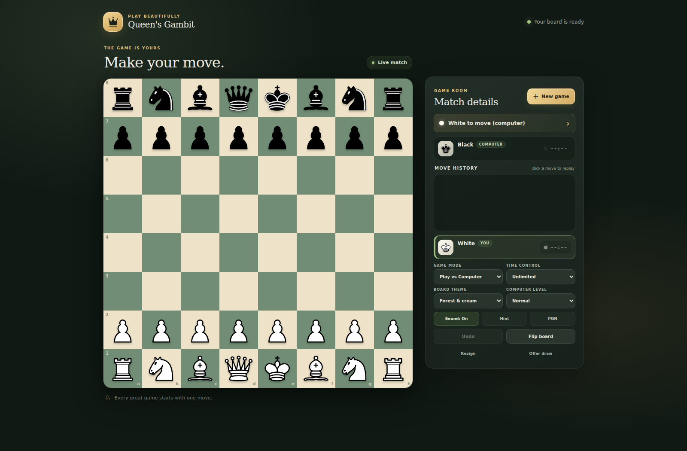

# Queen's Gambit

A lightweight chess game for your browser. Play against the computer or share the board with a friend, choose a time control, and make the board your own with six themes.

## Get the extension

1. [Download the extension ZIP](queens-gambit-extension.zip) and extract it.
2. Open `chrome://extensions` in Chrome or `edge://extensions` in Edge.
3. Turn on **Developer mode**, select **Load unpacked**, and choose the extracted folder containing `manifest.json`.
4. Open Queen's Gambit from the extensions menu to start a game.

## Play

Click a piece to see its legal moves, then click a highlighted square. Choose **Play vs Computer** or **Two players**, and set the difficulty or clock from the game panel. Use **Hint**, **Undo**, and **Flip board** during play; click a move in the history to review it. **PGN** copies the game notation to your clipboard.

The game runs locally in your browser and does not need an account or network access.
